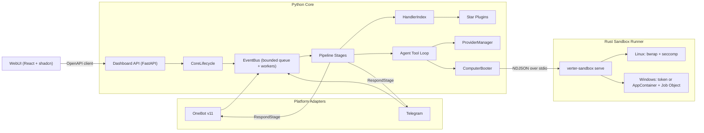
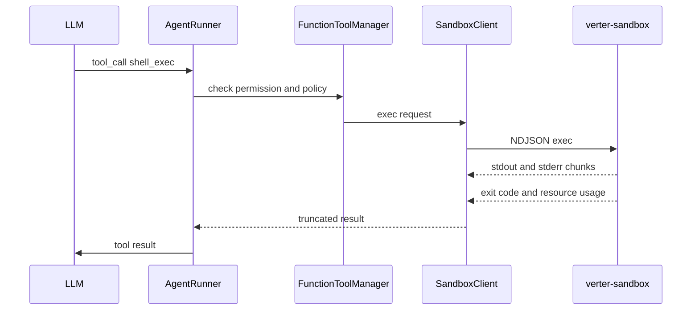

# Verter-Bot 开发计划（v2）

参考对象：[AstrBotDevs/AstrBot](https://github.com/AstrBotDevs/AstrBot) 的模块划分与运行流程。Verter-Bot 是独立实现，不是 fork。

> 许可证约束：AstrBot 使用 AGPL-3.0。本项目只参考架构与公开插件 API 的命名，不复制其源码、提示词或前端资源。Verter-Bot 自身的许可证需由仓库所有者确定。

## 0. 本版变更（相对 v1）

- 新增：本地 Linux / Windows 沙箱，可被 Agent 通过工具调用。
- 新增：WebUI 严格使用 shadcn/ui 组件库及其规范。
- 定稿：分组件的开发语言与核心依赖（第 2 节）。
- 新增：质量保障体系（第 8 节），覆盖效率、性能、质量、设计风格。
- 修订：性能设计用"索引分发"替代 v1 中"唤醒检查保持 O(handler 数)"的做法；阶段改为垂直切片交付（后端、API、WebUI 页面、测试一起完成）。

## 1. 目标与范围

| 维度 | 要求 |
|------|------|
| 结构 | 对齐 AstrBot：CoreLifecycle → EventBus → Pipeline（洋葱模型）→ Star 插件 / Provider → Respond |
| 平台（MVP） | OneBot v11（QQ，NapCat 等）+ Telegram |
| 能力（MVP） | Provider 管理、多平台、插件热加载、WebUI、本地沙箱（Linux + Windows） |
| 首要指标 | 运行性能；同时保证产品质量与统一的设计风格 |

MVP 之外（后续迭代）：知识库 / RAG、MCP、STT / TTS、Dify / Coze 等第三方 Agent Runner、更多平台。

## 2. 技术栈决策

### 2.1 结论

| 组件 | 语言 / 技术 | 职责 |
|------|-------------|------|
| 核心运行时 | Python 3.12+，asyncio（Linux 上启用 uvloop） | 生命周期、事件总线、流水线、插件、平台适配器、模型调用、WebUI 后端 API |
| 沙箱执行器 | Rust（独立二进制 `verter-sandbox`） | Linux / Windows 进程隔离、资源限制、文件与网络策略 |
| WebUI | TypeScript + React + Vite + Tailwind CSS v4 + shadcn/ui | 管理界面 |

### 2.2 理由

**核心用 Python：**

1. 结构与生态：要和 AstrBot 结构相似，插件 API 与之对齐后，AstrBot 插件只需改 import 和少量命名即可移植；插件热加载依赖 Python 的动态导入。
2. 负载特征：机器人是 I/O 密集型。真正的瓶颈是平台限速（Telegram 单聊约 1 条/秒、群组 20 条/分钟，见 [Bots FAQ](https://core.telegram.org/bots/faq#my-bot-is-hitting-limits-how-do-i-avoid-this)）和 LLM 延迟（秒级），而不是框架的微秒级开销。
3. 架构收益远大于语言收益：按 AstrBot 唤醒阶段的成本结构做了一个模拟测量（见附录 A）。在 1000 个 handler 时，索引分发约为逐个扫描的 300 倍；而 Python 分发本身每条消息只有约 1 微秒。

**沙箱用 Rust：**

1. 需要直接调用操作系统安全接口：Linux 的 namespace / seccomp / Landlock，Windows 的受限令牌 / ACL / Job Object / 防火墙。
2. 安全边界代码需要内存安全，并能编译成单个静态二进制，方便在 Linux 和 Windows 上分发。
3. Windows 上的隔离必须由独立进程完成。参考 [Codex 的 Windows 沙箱设计](https://openai.com/index/building-codex-windows-sandbox/)：命令需要由一个以沙箱用户身份运行的 runner 来创建受限令牌并启动。Python 主进程不进入安全边界。

**WebUI 用 TypeScript + React：** shadcn/ui 是 React 组件体系；配合严格模式的 TypeScript，以及由 OpenAPI 生成的客户端，前后端可以共用同一套类型。

### 2.3 放弃的方案

- Go 或 Rust 全栈：插件只能走 RPC 或 WASM，失去 AstrBot 插件的可移植性和热加载能力，业务开发效率也明显下降。
- TypeScript 全栈：统一了语言，但放弃了 Python 插件生态，与"结构类似 AstrBot"的目标冲突。
- 纯 Python 沙箱（AstrBot 的做法）：Linux 上调用 bubblewrap 可行，但 Windows 的安全接口用 ctypes 维护成本高，而且仍然需要独立的 runner 进程。

### 2.4 核心依赖

- **Python**
  - 运行时：aiohttp（OneBot WS 服务端、Telegram Bot API、OpenAI 兼容客户端）、FastAPI + uvicorn（WebUI API 与 OpenAPI 文档）、pydantic v2（配置与 API 模型）、orjson、aiosqlite（WAL 模式）、uvloop（非 Windows）。
  - 工具链：uv、ruff、pyright、pytest、pytest-asyncio、hypothesis。
  - 不引入 AstrBot 依赖清单中的重型包（pandas、faiss、多家官方 SDK 等）。所有平台和模型实现按配置懒加载。
- **Rust**
  - 运行时：tokio、serde、schemars（导出协议 JSON Schema）。
  - Linux：bubblewrap（外部依赖）、seccompiler、landlock。
  - Windows：windows-rs（令牌、ACL、Job Object、AppContainer、防火墙）。
  - 工具链：clippy、rustfmt、cargo-deny。
- **WebUI**
  - 运行时：React 19、shadcn/ui（Base UI）、lucide-react、TanStack Router / Query / Table、react-hook-form + zod、Sonner、shadcn Chart、i18next。
  - 工具链：pnpm、ESLint、Prettier（含 Tailwind 类名排序插件）、Vitest、Playwright、axe-core。

## 3. 总体架构



流水线阶段顺序与 AstrBot 一致：`WakingCheck → WhitelistCheck → SessionStatusCheck → RateLimit → ContentSafetyCheck → PreProcess → Process（插件 → LLM）→ ResultDecorate → Respond`。保留 `STAGES_ORDER` 和 `@register_stage`，handler 每 `yield` 一次结果，就立即经过修饰和发送阶段（洋葱模型）。

## 4. 仓库结构（monorepo）

```text
verter/                      # Python 核心包
  core/
    core_lifecycle.py  event_bus.py  config.py  log.py  db.py  metrics.py  conversation_mgr.py
    message/                 # 消息组件、MessageChain、MessageEventResult
    pipeline/                # scheduler / stage / stage_order + 各阶段子目录
    platform/                # Platform 基类、事件、管理器、注册；sources/{onebot,telegram,console}
    provider/                # Provider 基类、管理器、FunctionToolManager；sources/openai_compat.py
    star/                    # Star、Context、注册装饰器、过滤器、HandlerIndex、PluginManager
    computer/                # ComputerBooter（local / docker）、SandboxClient、Agent 沙箱工具
  api/                       # 插件公共 API（对齐 astrbot.api 的组织方式）
  builtin_stars/             # 内置指令插件
  dashboard/                 # FastAPI 路由；托管 webui 构建产物
  cli/                       # verter init / run / doctor
sandbox/                     # Rust workspace
  crates/protocol            # 请求/响应类型 → JSON Schema
  crates/linux               # bubblewrap 启动、seccomp、Landlock 回退
  crates/windows             # 受限令牌 / AppContainer、Job Object、ACL、防火墙
  crates/cli                 # verter-sandbox：serve / setup / doctor
webui/                       # React + shadcn
  components.json
  src/components/ui/         # 仅由 shadcn CLI / MCP 写入
  src/components/            # 业务组合组件
  src/routes/                # 页面
  src/lib/api/               # 由 OpenAPI 生成
tests/  benchmarks/  docs/
pyproject.toml  uv.lock  justfile  .github/workflows/
```

## 5. 核心性能设计

依据 AstrBot 源码中可以改进的点：

- [`event_bus.py`](https://github.com/AstrBotDevs/AstrBot/blob/master/astrbot/core/event_bus.py) 每个事件直接 `create_task`，没有并发上限和背压。
- [`waking_check/stage.py`](https://github.com/AstrBotDevs/AstrBot/blob/master/astrbot/core/pipeline/waking_check/stage.py) 每条消息遍历全部 handler，并逐个运行过滤器。
- [`star_handler.py`](https://github.com/AstrBotDevs/AstrBot/blob/master/astrbot/core/star/star_handler.py) 的 `get_handlers_by_event_type` 每次调用都重新扫描并生成列表。

对应措施：

1. **HandlerIndex**：插件加载、卸载或启停时构建不可变索引并整体替换。索引包括：指令首词字典与指令组子树、正则列表、按消息类型分桶的监听器、按事件类型预先排好优先级的钩子。每条消息只做一次空白规整和一次字典查找；平台、权限、自定义过滤器只对候选 handler 执行。未唤醒消息的拒绝成本与 handler 数量无关。
2. **EventBus**：有界队列 + 固定数量的 worker，队列满时丢弃并计数，不会无限创建任务。保留 AstrBot 的语义：只有 LLM 调用和会话写入按会话串行；锁表按引用计数回收，不经过全局锁。Provider 另有并发上限，保护上游 API 配额。
3. **启动与内存**：依赖精简，平台和模型实现按配置懒加载；handler 的参数解析器在注册时编译好。
4. **网络层**：统一使用 aiohttp 连接池和 keep-alive，JSON 用 orjson；OneBot 直接基于 aiohttp WebSocket 实现（AstrBot 经由 aiocqhttp 跑在 Quart / Hypercorn 上）。
5. **存储**：SQLite WAL 模式；会话历史使用 LRU 缓存并合并写入，退出时落盘，也可配置为直写。
6. **日志**：通过 QueueHandler 由后台线程写日志，不阻塞事件循环；保留一个环形缓冲区供 WebUI 实时查看。
7. **沙箱**：runner 常驻，避免每次调用都启动辅助进程；工作区按会话复用；输出以流式返回，并限制大小。
8. **WebUI**：路由级代码分割；静态资源带哈希、长缓存并压缩；用 SSE 推送替代轮询。

## 6. 本地沙箱（Agent 可调用）

现状：AstrBot 的本地进程沙箱只支持 Linux（bubblewrap）和 macOS（Seatbelt），在 Windows 上会报 `No Local process sandbox backend is available`（见 [`process_sandbox/__init__.py`](https://github.com/AstrBotDevs/AstrBot/blob/master/astrbot/core/computer/process_sandbox/__init__.py)）。Verter-Bot 需要补上 Windows。

### 6.1 调用链



- 提供给 Agent 的工具：`shell_exec`、`python_exec`、`fs_read`、`fs_write`、`fs_list`。所有路径都相对于会话工作区。
- 协议：Rust 类型通过 schemars 导出 JSON Schema，再生成 Python 模型；CI 检查两边是否一致。

### 6.2 安全策略

| 维度 | 默认值 |
|------|--------|
| 文件系统 | 系统目录只读；会话工作区 `data/workspaces/<会话哈希>/` 可写；其余位置不可写 |
| 网络 | 默认禁止，可按策略开放 |
| 资源 | 墙钟超时、CPU 时间、内存、进程数、输出大小均有上限；超时会结束整个进程树 |
| 环境变量 | 启动时清空，只注入白名单变量；API Key 不能进入沙箱 |
| 调用权限 | 默认仅管理员会话可用，可按会话白名单放开 |
| 审计 | 每次调用记录会话、发起人、命令、耗时、退出码和截断后的输出，存入 SQLite，可在 WebUI 查看 |

### 6.3 Linux 后端

- 首选 bubblewrap：隔离 user / pid / net / mount / ipc 命名空间，开启 `--die-with-parent` 与 `--new-session`，系统目录只读挂载，`/tmp` 使用 tmpfs。
- 在此之上设置 `no_new_privs`，并用 seccomp 禁止 ptrace、io_uring 等调用；网络关闭时同时禁止建立连接。
- 资源限制使用 rlimit；如果 cgroup v2 已委派给当前用户，则改用 cgroup。
- 回退：当非特权 user namespace 不可用时（部分发行版默认限制），改用 Landlock + seccomp；`verter-sandbox doctor` 负责检测并提示。

### 6.4 Windows 后端

- **标准模式（无需管理员）**：AppContainer 或受限令牌，配合 Job Object（内存、CPU、进程数限制，句柄关闭即结束进程树），并为工作区设置 ACL。AppContainer 在未授予网络能力时由系统强制断网；受限令牌模式只能做"建议性"的网络屏蔽，因此该模式只允许在开放网络的策略下使用。
- **强隔离模式（需要一次性管理员初始化 `verter-sandbox setup`）**：创建专用的离线 / 在线本地用户，用防火墙规则阻断离线用户的出站流量，再叠加受限令牌和 Job Object。runner 先以沙箱用户身份启动，再创建受限令牌并启动子进程（参考 Codex 公开的设计）。
- 默认模式由 S0 技术验证决定：在 windows-latest 上测试 python、powershell、cmd、git 在 AppContainer 下的兼容性和隔离效果。

### 6.5 Docker 后端（可选，两个系统通用）

每个会话一个容器，用于把沙箱开放给群聊中非管理员用户的场景，对应 AstrBot 的 Shipyard 方案。

### 6.6 安全测试集

在 ubuntu-latest 和 windows-latest 上运行，覆盖：

- 越界写入、读取敏感文件
- 外网连接
- fork 炸弹、内存炸弹
- 超时
- 超时后孙进程是否仍然存活
- 环境变量泄露

## 7. WebUI（严格遵循 shadcn 规范）

### 7.1 初始化

使用 `shadcn init -t vite` 初始化。shadcn 自 2026 年 7 月起新项目默认使用 Base UI（[changelog](https://ui.shadcn.com/docs/changelog/2026-07-base-ui-default)），本项目跟随默认；Radix 仍受完整支持，只需加上 `-b radix`。主题统一用 CSS 变量定义 token，提供亮、暗两套。

### 7.2 硬性规则

1. `src/components/ui/` 只能通过 shadcn CLI 或 MCP 写入，不手写基础组件。定制通过 CSS 变量和组合完成；确实需要修改组件内部时，必须在 PR 中说明原因。
2. 业务组件只能组合 `components/ui` 中的组件。用 ESLint `no-restricted-imports` 禁止引入其他 UI 库，并禁止在 `components/ui` 以外直接导入 Base UI / Radix 原语。
3. 颜色、圆角、阴影只能使用主题 token，禁止硬编码色值和任意值颜色。
4. 图标只用 lucide。
5. 固定搭配：表单用 shadcn Field + react-hook-form + zod，表格用 shadcn Data Table（TanStack Table），图表用 shadcn Chart，通知用 Sonner，布局用 shadcn Sidebar block。
6. 每个页面都必须覆盖加载、空数据、错误三种状态，支持键盘操作、亮暗主题和中英文。

### 7.3 页面清单

页面与阶段绑定交付：登录、概览（指标）、平台、模型提供商、插件、会话与人格、沙箱（策略、审计、实时输出）、日志、设置。

### 7.4 AI 辅助开发

- 启用 [shadcn MCP Server](https://ui.shadcn.com/docs/mcp) 和 [shadcn Skill](https://ui.shadcn.com/docs/skills)。Skill 通过 `shadcn info --json` 读取项目配置，让代理先查组件和示例，再写代码。
- PR 使用 shadcn MCP 提供的审计清单（`get_audit_checklist`）自检。

### 7.5 API 契约

由 FastAPI 的 OpenAPI 文档生成 TypeScript 客户端和 TanStack Query hooks；CI 检查生成物是否过期。

## 8. 质量保障体系

| 目标 | 机制 |
|------|------|
| 开发效率 | monorepo + `just` 统一命令（`just dev` 同时启动带模拟平台的后端和 Vite）；接口代码全部生成，不手写同步；模拟 OneBot、Telegram、LLM 服务，开发不依赖真实账号 |
| 运行性能 | CI 基准测试 + 性能预算，回归超阈值即失败（见 8.2） |
| 产品质量 | 契约优先、静态检查、分层测试、垂直切片交付（见 8.1、8.3） |
| 设计风格 | shadcn 规则与 lint、视觉回归、无障碍检查（见第 7 节和 8.4） |

### 8.1 契约与静态检查

- 三份契约：后端与 WebUI 之间的 OpenAPI，Python 与 Rust 之间的 JSON Schema，以及插件 API 文档。
- Python：ruff + pyright（`verter/core` 使用 strict）。
- TypeScript：strict + ESLint + Prettier。
- Rust：clippy `-D warnings` + rustfmt + cargo-deny。

### 8.2 性能预算

以下是初始目标，P1 或 S0 测出基线后锁定为回归阈值（劣化超过 10% 即失败）：

- 分发层：handler 数从 100 增加到 5000 时，未唤醒消息的分发耗时增长小于 10%。
- 端到端（不含 LLM 和网络）：单条指令消息处理 p99 小于 1 ms。
- 空载内存（OneBot + Telegram，无插件）：RSS 小于 80 MB。
- 冷启动到可接收消息：小于 2 秒。
- 沙箱执行一次 `echo` 的额外开销：Linux 小于 50 ms，Windows 小于 200 ms。
- WebUI 首屏 JS（gzip 后）：小于 250 KB。

### 8.3 测试分层

- 单元测试：pytest、Vitest、cargo test。
- 集成测试：模拟 OneBot 客户端、Telegram API 和 LLM 服务。
- 端到端：Playwright 驱动 WebUI，连接后端和模拟平台。
- 沙箱安全测试：见 6.6。
- 覆盖率门槛：Python 核心 85%，沙箱 crate 80%。

### 8.4 设计一致性

- Playwright 视觉回归：关键页面 × 亮 / 暗 × 中 / 英。
- axe-core 无障碍检查。
- PR 模板包含 UI 自检清单：三态、键盘操作、主题、文案。

### 8.5 流程

- 每个阶段是一个垂直切片：后端、API、WebUI 页面、测试、文档一起交付，并有明确的验收标准。
- 使用 Conventional Commits。
- 所有 PR 必须在 Linux 和 Windows 上 CI 全绿。

## 9. 阶段计划

### P0 基建与质量门禁（已完成，#2）

- 交付：monorepo 骨架；CI 矩阵（ubuntu + windows，Python 3.12 / 3.13）；三种语言的 lint、类型检查和测试；两条代码生成流水线；基准测试框架；shadcn 初始化、主题 token、AppShell 和登录页。
- 验收：`just check` 在两个系统上全绿；WebUI 空壳在亮暗主题下通过视觉快照。

### P1 核心运行时（同步进行 S0 沙箱技术验证）

细化后的范围、验收标准、PR 拆分和待确认事项见 [P1_S0_PLAN.md](P1_S0_PLAN.md)。

- 交付：消息模型、EventBus、9 个流水线阶段、Star 插件系统、HandlerIndex、热加载、控制台调试适配器、内置指令、指标；WebUI 概览页和插件页。
- S0：Linux bubblewrap 原型；Windows AppContainer 与受限令牌两种原型的对比报告。
- 验收：控制台跑通指令；热加载无需重启进程；基准测试满足 8.2 中的分发层目标，基线写入仓库；S0 报告确定 Windows 默认模式。

### P2 平台适配

- 交付：OneBot v11（反向 + 正向 WebSocket）、Telegram（长轮询）、PlatformManager；WebUI 平台页。
- 验收：NapCat 群聊和私聊收发正常；Telegram 私聊和群聊正常；断线可重连；模拟客户端集成测试通过。

### P3 模型与会话

- 交付：OpenAI 兼容 Provider（流式、工具调用、多 Key 轮换、重试）、ProviderManager、会话管理、人格、工具循环 Agent；WebUI 提供商、会话、人格页。
- 验收：多用户并发时上下文不串；工具调用循环在模拟 LLM 下通过；连接测试按钮可用。

### P4 沙箱

- 交付：`verter-sandbox` 的 Linux 与 Windows 后端、SandboxClient、ComputerBooter、Agent 工具、审计；可选 Docker 后端；WebUI 沙箱页。
- 验收：6.6 的安全测试集在 ubuntu-latest 和 windows-latest 上全部通过；Agent 能在会话工作区内执行 Python 和 Shell 并返回结果；未授权会话的调用被拒绝并记入审计。

### P5 发布与加固

- 交付：Docker 镜像；Windows 便携包（内含 `verter-sandbox.exe`）；Rust 二进制以平台 wheel 形式随 Python 包分发；压力测试与长时间稳定性测试；部署、插件开发、沙箱安全模型文档。
- 验收：在全新的 Linux 和 Windows 机器上按文档部署成功；发布流水线产出多平台产物。

## 10. 配置示意

```yaml
wake_prefix: ["/"]
admins_id: ["your_qq_or_tg_id"]
platform:
  - { id: qq_main, type: onebot_v11, enable: true, ws_reverse_host: "0.0.0.0", ws_reverse_port: 6199, access_token: "ENV:ONEBOT_TOKEN" }
  - { id: tg_main, type: telegram, enable: true, token: "ENV:TELEGRAM_BOT_TOKEN" }
provider:
  - { id: openai_main, type: openai_compat, api_base: "https://api.openai.com/v1", api_keys: ["ENV:OPENAI_API_KEY"], model: "gpt-4o-mini", max_concurrency: 8 }
provider_settings: { enable: true, default_provider_id: openai_main, max_context_messages: 40 }
runtime: { max_pending_events: 10000, workers: 64, event_timeout_s: 300 }
computer:
  enable: true
  backend: local            # local | docker
  allow: admins             # admins | whitelist | all
  network: deny             # deny | allow
  windows_mode: auto        # auto | standard | isolated
  limits: { timeout_s: 60, cpu_s: 30, memory_mb: 512, max_procs: 64, output_kb: 64 }
dashboard: { enable: true, host: "127.0.0.1", port: 6185 }
plugin_set: ["*"]
```

## 11. 模块对照

| AstrBot | Verter-Bot |
|---------|------------|
| `core/core_lifecycle.py` | `verter/core/core_lifecycle.py` |
| `core/event_bus.py` | `verter/core/event_bus.py` |
| `core/pipeline/*` | `verter/core/pipeline/*` |
| `core/platform/*` | `verter/core/platform/*` |
| `core/star/*` | `verter/core/star/*`（新增 HandlerIndex） |
| `core/provider/*` | `verter/core/provider/*` |
| `core/computer/*` | `verter/core/computer/*` + `sandbox/`（Rust） |
| `core/conversation_mgr.py` | `verter/core/conversation_mgr.py` |
| `dashboard/`（Vue + Vuetify） | `verter/dashboard/`（FastAPI）+ `webui/`（React + shadcn） |
| `builtin_stars/*` | `verter/builtin_stars/*` |

## 12. 风险

1. AGPL 污染：禁止复制 AstrBot 代码，只按行为描述自行实现。
2. Windows 沙箱复杂度高：S0 先验证再定方案；强隔离模式需要管理员初始化，必须在文档中说清楚。
3. bubblewrap 受 user namespace 限制：已确认 Ubuntu 24.04 及以上（包括 GitHub ubuntu-24.04 Runner）默认通过 AppArmor 限制非特权 user namespace（见 [P1_S0_PLAN.md](P1_S0_PLAN.md) 4.1）。用 Landlock + seccomp 或 Docker 回退，并由 `doctor` 命令检测。
4. OneBot 实现之间存在差异：以 NapCat 为主测对象，只依赖 OneBot v11 标准接口。
5. Telegram 群组隐私模式：机器人默认收不到非指令消息，需要在文档中说明设置方法。
6. 插件热加载的模块卸载不一定干净：明确卸载契约（handler、平台注册、后台任务），并编写测试。
7. 范围蔓延：MVP 之外的功能不得阻塞当前阶段。

## 附录 A：分发成本模拟测量

方法：纯 asyncio（未启用 uvloop），单进程，16 个 worker，10 万条消息，测量范围仅限分发层。

- 逐个扫描：每条消息重建候选列表，并逐个调用 handler 的过滤器对象；未唤醒消息提前返回，已唤醒消息做空白规整和前缀匹配。
- 索引分发：未唤醒消息直接拒绝，已唤醒消息取首词做一次字典查找。

结果（唤醒比例 10%）：

| handler 数 | 索引分发（事件/秒） | 逐个扫描（事件/秒） |
|-----------|-------------------|-------------------|
| 10 | 约 120 万 | 约 25 万 |
| 100 | 约 116 万 | 约 3.4 万 |
| 1000 | 约 120 万 | 约 3,500 |
| 5000 | 约 115 万 | 约 700 |

这是对成本结构的模拟，不是对 AstrBot 的实测。正式对比放在 P1 的基准测试中完成。
