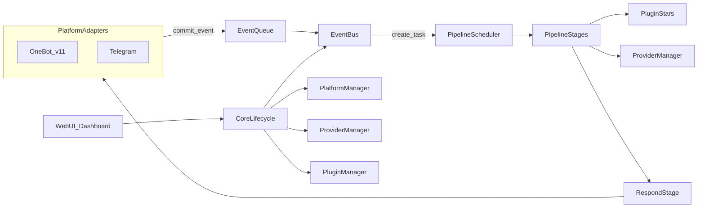

# Verter-Bot Development Plan

Reference target: [AstrBotDevs/AstrBot](https://github.com/AstrBotDevs/AstrBot) architecture (structure and behavior), **not** a source fork.

**License note:** AstrBot is AGPL-3.0. Verter-Bot must be an independent implementation. Do not copy AstrBot source files, prompts, or dashboard assets. Mirror module boundaries and runtime flow only.

## Goals

| Goal | Decision |
|------|----------|
| Structure | Align with AstrBot: Lifecycle → EventBus → Pipeline → Stars / Provider → Respond |
| Platforms (MVP) | OneBot v11 (`aiocqhttp` reverse WS) + Telegram |
| Scope (MVP) | Near-AstrBot subset: Provider manager, multi-platform, plugin hot-reload, simple WebUI |
| Performance | asyncio-first; bounded queue; per-session locks; concurrent pipelines; hot path without sync I/O |

Out of MVP (Phase 2+): Knowledge Base / RAG, MCP, Agent Sandbox, STT/TTS, Dify/Coze runners, multi-language Dashboard parity, WhatsApp, etc.

## Architecture



### Runtime data flow

1. Adapter receives platform message → convert to `VerterMessage` + `VerterMessageEvent`
2. `Platform.commit_event(event)` puts event on `asyncio.Queue`
3. `EventBus.dispatch` loop: `get` → log → `asyncio.create_task(scheduler.execute(event))` (strong refs on pending tasks)
4. `PipelineScheduler` runs stages in fixed order; stages that return async generators implement the onion model (pre-yield → next stages → post-yield)
5. `ProcessStage`: activated Star handlers first; if still wake and no terminal send, call LLM Provider
6. `RespondStage` sends `MessageEventResult` via platform-specific `event.send`
7. Session lock around LLM turns for the same `unified_msg_origin` to avoid interleaved context writes

### Pipeline stage order (MVP)

Mirror AstrBot’s order; keep unused stages as thin stubs until needed:

1. `WakingCheckStage` — wake prefix / @ / private chat / command filter match
2. `WhitelistCheckStage` — optional ID whitelist
3. `SessionStatusCheckStage` — session enable flag
4. `RateLimitStage` — per-UMO token bucket / sliding window
5. `ContentSafetyCheckStage` — keyword blocklist (local only in MVP)
6. `PreProcessStage` — normalize text, strip wake prefix, attach session id
7. `ProcessStage` — Stars then Provider
8. `ResultDecorateStage` — reply prefix, mention, markdown flag
9. `RespondStage` — send + after-send hooks

## Target package layout

```text
verter/
  __init__.py
  __main__.py                 # python -m verter
  cli.py                      # init / run / plugin commands
  core/
    lifecycle.py              # CoreLifecycle: wire managers + start/stop
    event_bus.py
    config.py                 # pydantic settings + YAML/JSON load
    workspace.py              # data/ paths
    log.py
    conversation.py           # ConversationManager
    session_lock.py
    message/
      components.py           # Plain, At, Image, Reply, Record, File (MVP set)
      result.py               # MessageChain, MessageEventResult
    pipeline/
      stage.py                # Stage ABC + register_stage
      stage_order.py
      context.py
      scheduler.py
      bootstrap.py
      waking_check/
      whitelist_check/
      session_status_check/
      rate_limit/
      content_safety/
      preprocess/
      process/                # star_request + provider_request
      result_decorate/
      respond/
    platform/
      base.py                 # Platform ABC
      event.py                # VerterMessageEvent
      message.py              # VerterMessage, MessageType
      manager.py
      register.py
      sources/
        console/              # local REPL for tests (dev only)
        aiocqhttp/            # OneBot v11
        telegram/
    provider/
      base.py                 # Provider ABC (text_chat / stream)
      manager.py
      register.py
      sources/
        openai_compat.py      # OpenAI + DeepSeek + Ollama-compatible
    star/
      base.py                 # Star plugin base
      manager.py              # load / unload / hot-reload
      handler.py              # registry + EventType
      filters/                # command, regex, permission, platform, msg type
      register.py             # @register_command etc.
  dashboard/
    server.py                 # FastAPI: status, config, plugins, platforms, providers
    static/                   # minimal SPA or Jinja pages
  builtin_stars/
    builtin_commands/         # /help /plugin /provider /reset etc.
plugins/                      # user plugins (data/plugins at runtime)
tests/
  unit/
  integration/
pyproject.toml
README.md
```

## Performance design (non-negotiable)

1. **Async end-to-end** — adapters, pipeline, provider HTTP, DB all async; no blocking calls on the event loop (use `asyncio.to_thread` only for rare sync libs).
2. **Bounded event queue** — `asyncio.Queue(maxsize=N)`; backpressure metrics when full; never unbounded growth under flood.
3. **Concurrent pipelines** — one task per event (like AstrBot EventBus); do **not** process the queue serially.
4. **Per-session lock** — `SessionLockManager` keyed by `unified_msg_origin` around conversation read/LLM/write.
5. **Handler filter short-circuit** — cheap filters first (platform / message type / permission) before command parse; keep waking-check O(handlers) but cache enabled plugin list.
6. **Hot reload isolation** — reload one plugin module; unregister its handlers/adapters; avoid full process restart for plugin edits.
7. **HTTP client reuse** — single `httpx.AsyncClient` / openai client pool per provider instance.
8. **Structured logging** — loguru (or std logging) with category; debug off on hot path in production.
9. **DB** — SQLite + SQLAlchemy async (aiosqlite) for conversations/stats; WAL mode; no sync ORM on hot path.
10. **Metrics hooks** — queue depth, pipeline latency histogram, provider latency; expose on Dashboard `/api/metrics`.

## Phase plan

### Phase 0 — Scaffold (foundation)

Deliverables:

- `pyproject.toml` (Python ≥3.12), package `verter`, ruff + pytest
- Config schema (`wake_prefix`, `admins_id`, platform list, provider list, dashboard)
- Logging + workspace (`data/`, `data/plugins/`, `data/config.yaml`)
- `CoreLifecycle` skeleton: create queue, start/stop hooks
- Console adapter that reads stdin / simple TCP and emits events (for offline tests)

Acceptance:

- `python -m verter run` starts, loads config, shuts down cleanly on SIGINT
- Unit test: event put → EventBus → noop pipeline stage → done

### Phase 1 — Pipeline + Stars (command bot)

Deliverables:

- Stage ABC, scheduler (onion model), stage order registration
- Message components + `MessageEventResult`
- Star base, handler registry, filters: `command`, `regex`, `permission`, `event_message_type`, `platform`
- Decorators: `@register_command`, `@register_regex`, `@on_verter_loaded`, `@after_message_sent`
- Builtin commands: `/help`, `/echo`, `/sid`
- Waking / whitelist / rate limit / process(star) / decorate / respond stages
- PluginManager: scan `data/plugins`, import, register metadata (`metadata.yaml`), enable/disable, **hot-reload** one plugin

Acceptance:

- Console: `/echo hi` replies
- Drop a sample plugin into `data/plugins`, `/plugin reload name` works without process restart
- Rate limit drops floods for same UMO

### Phase 2 — Platforms: OneBot v11 + Telegram

Deliverables:

- `Platform` ABC: `run`, `terminate`, `meta`, `commit_event`, `create_event`, `send_by_session`
- **aiocqhttp** reverse WebSocket adapter (host/port/token from config); map group/private/notice → `VerterMessage`
- **Telegram** adapter via `python-telegram-bot` (long polling first; webhook optional later)
- PlatformManager: load from config, task-per-platform, reload/terminate by `platform_id`
- Event fields aligned with AstrBot concepts: `unified_msg_origin`, `session_id`, `is_wake`, `role`

Acceptance:

- NapCat / Lagrange / other OneBot client connects; bot replies in QQ group when woken
- Telegram bot replies in private and group (group requires wake/@)
- Dashboard or logs show adapter online/offline

### Phase 3 — Provider + conversations (chat bot)

Deliverables:

- `Provider` ABC: `text_chat`, optional `text_chat_stream`
- OpenAI-compatible source (base_url + api_key + model) covering OpenAI / DeepSeek / Ollama / OneAPI
- ProviderManager: list, default provider, switch, test connection
- ConversationManager: create/switch/delete/get history; persist in SQLite
- ProcessStage: after Stars, if wake and no terminal plugin reply → LLM
- Session lock around LLM; context window trim (max messages / tokens estimate)
- Builtin: `/reset`, `/provider`, `/model` (admin)

Acceptance:

- Wake in QQ/Telegram → LLM reply with history continuity
- Concurrent users do not mix contexts
- Stream path optional: if platform supports, stream chunks; else buffer then send

### Phase 4 — Dashboard (simple WebUI)

Deliverables:

- FastAPI app (port configurable, default e.g. 6185)
- Auth: single admin user + password from config (JWT or signed cookie)
- Pages/APIs:
  - Status: uptime, queue depth, platforms, providers
  - Config view/edit (safe subset)
  - Platforms: list / enable / reload
  - Providers: list / test / set default
  - Plugins: list / enable / disable / reload / upload zip (optional)
  - Logs: recent ring buffer SSE or poll
- Minimal frontend: server-rendered Jinja **or** small Vite SPA; keep UI thin

Acceptance:

- Fresh install: open Dashboard, login, see adapters and set API key without editing YAML by hand
- Reload plugin from UI reflected in runtime

### Phase 5 — Hardening + performance pass

Deliverables:

- Integration tests with mocked OneBot/Telegram events
- Load test: synthetic EventBus flood (e.g. 1k events) — measure p95 pipeline latency without LLM
- Graceful shutdown: drain or cancel in-flight pipeline tasks with timeout
- Content safety + whitelist wired to config
- Error hooks: `OnPluginError`; user-facing short error when wake command fails
- Docs: deploy (uv / Docker), plugin authoring guide, config reference

Acceptance:

- CI: lint + unit + integration green
- Documented Docker Compose: Verter + optional NapCat sidecar sketch
- README quickstart for QQ + Telegram + OpenAI-compatible key

## Config sketch (MVP)

```yaml
wake_prefix: ["/"]
admins_id: ["your_qq_or_tg_id"]
platform_settings:
  friend_message_needs_wake_prefix: false
  ignore_bot_self_message: true
  rate_limit:
    type: "window"
    count: 8
    time: 60
platform:
  - id: qq_main
    type: aiocqhttp
    enable: true
    ws_reverse_host: "0.0.0.0"
    ws_reverse_port: 6199
  - id: tg_main
    type: telegram
    enable: true
    token: "ENV:TELEGRAM_BOT_TOKEN"
provider:
  - id: openai_main
    type: openai_chat_completion
    enable: true
    api_key: "ENV:OPENAI_API_KEY"
    api_base: "https://api.openai.com/v1"
    model: "gpt-4o-mini"
provider_settings:
  enable: true
  default_provider_id: openai_main
  max_context_messages: 40
dashboard:
  enable: true
  host: "0.0.0.0"
  port: 6185
  username: admin
  password: change_me
plugin_set: ["*"]
```

## Plugin API (target DX)

```python
from verter.api import Star, register_command, register_star

@register_star(name="hello", desc="sample", version="0.1.0")
class Hello(Star):
    @register_command("hello")
    async def hello(self, event, name: str = "world"):
        yield event.plain_result(f"hello, {name}")
```

Compatibility goal: **conceptually** close to AstrBot Star API so authors can port plugins with small renames (`astrbot` → `verter`), not binary API compatibility.

## Mapping to AstrBot modules

| AstrBot | Verter-Bot |
|---------|------------|
| `core_lifecycle.py` | `core/lifecycle.py` |
| `event_bus.py` | `core/event_bus.py` |
| `pipeline/*` | `core/pipeline/*` |
| `platform/*` | `core/platform/*` |
| `star/*` | `core/star/*` |
| `provider/*` | `core/provider/*` |
| `conversation_mgr.py` | `core/conversation.py` |
| `dashboard/*` | `dashboard/*` |
| `builtin_stars/*` | `builtin_stars/*` |

## Risks and constraints

1. **AGPL contamination** — never paste AstrBot code; reimplement from behavior notes in this plan.
2. **OneBot ecosystem variance** — NapCat / Lagrange / go-cqhttp differ; stick to OneBot v11 message + send API; test with one primary client (recommend NapCat).
3. **Telegram group privacy** — bot must be group admin or privacy mode disabled for non-command messages; document this.
4. **Scope creep** — KB / MCP / sandbox explicitly deferred; reject feature PRs that block MVP.
5. **Hot reload** — Python `sys.modules` eviction is brittle; define clear unload contract (handlers, platform registrations, background tasks).

## Milestone checklist

- [ ] Phase 0 scaffold + console adapter
- [ ] Phase 1 pipeline + stars + hot-reload
- [ ] Phase 2 OneBot + Telegram
- [ ] Phase 3 Provider + conversations
- [ ] Phase 4 Dashboard
- [ ] Phase 5 tests, Docker, docs

## Immediate next implementation step

After this plan is approved: implement **Phase 0 + Phase 1** on branch, with console adapter and sample plugin, so structure and performance skeleton are reviewable before wiring QQ/Telegram.
